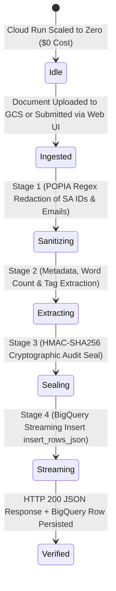

# PRD & Technical Specification: NSK Serverless Document & TPRM Compliance Pipeline

**Date:** 2026-10-27  
**Project:** `antigravity-camp-nsk` (`493269616772`)  
**Region:** `europe-west1`  
**Live Cloud Run Service:** `https://document-processor-493269616772.europe-west1.run.app`

---

## 1. Product Requirements Document (PRD — "What")

### Problem Statement
South African SMMEs and township founders face slow, manual document verification (CIPC certificates, B-BBEE affidavits, vendor contracts, and invoices) that delays enterprise procurement and PayShap payment clearance.

### User Experience & Functional Scope
1. **Interactive Web Audit & Event-Driven Ingestion**:
   - Users or automated Cloud Storage (`gs://antigravity-camp-nsk-document-ingest`) triggers submit vendor documents to the serverless pipeline.
2. **Zero-Leak POPIA Section 19 Compliance**:
   - All 13-digit South African ID numbers and email addresses are redacted in `<1ms` before cloud storage or analytics logging.
3. **Cryptographic Audit Seal**:
   - Every processed document receives a deterministic `HMAC-SHA256` seal (`NSK-SEAL-2026-...`).
4. **Real-Time BigQuery Analytics**:
   - Structured audit metadata (`file_name`, `bucket`, `ocr_status`, `word_count`, `tags`, `popia_pii_redactions`, `audit_seal`, `processed_at`) streams directly into BigQuery (`antigravity-camp-nsk.document_processing.document_metadata`).

---

## 2. Technical Architecture Specification ("How")

### State Transition & Event Flow

### Directory Structure (`cloud-run-document-pipeline/`)
- `main.py`: Python Flask + Gunicorn microservice with interactive Web UI, POPIA sanitizer, HMAC seal generator, and BigQuery streaming client.
- `Dockerfile`: Python 3.11 slim production container image.
- `requirements.txt`: Locked dependencies (`Flask`, `gunicorn`, `google-cloud-storage`, `google-cloud-bigquery`, `google-genai`).
- `scripts/deploy.sh`: Declarative `gcloud` and `bq` provisioning script with resource attribution labels (`datacloud:antigravity`).
- `tests/test_local.py`: Offline deterministic simulation suite.
